<div align="center">

# 💪 Jiggy Athletic Club

**A full-stack gym website, member portal and admin panel.**
Browse classes, book a free trial, join a plan, track your progress, and manage the whole gym from one place.


<!-- 👇 Replace with your hero screenshot (the homepage works well) -->


[Features](#-features) · [Screenshots](#-screenshots) · [Tech Stack](#-tech-stack) · [Getting Started](#-getting-started) · [Admin Panel](#-admin-panel) · [API](#-api-overview) · [Troubleshooting](#-troubleshooting)

</div>

---

## ✨ Features

**Public website**
- Home page with stats, "why train with us", plan preview and testimonials
- Activities and coaches, each with a detail page
- Weekly class schedule with live availability and one-click booking
- Membership plans comparison
- Free trial booking form (works for visitors and members)
- Gallery, blog and contact form

**Member accounts**
- Register, login, logout, forgot and reset password
- Dashboard with upcoming classes, membership status, workout history, attendance chart and progress chart
- Edit profile, book and cancel classes

**Admin panel**
- Add, edit and delete activities, coaches, classes, membership plans, gallery photos and testimonials
- View free trial requests and contact messages, and update their status
- See all members, deactivate accounts, or promote someone to admin
- Changes show on the public site straight away

**Under the hood**
- JWT in an `httpOnly` cookie, passwords hashed with bcrypt
- Zod validation, rate limiting, Helmet, CORS and centralized error handling
- Response compression and short-lived caching for public data
- All content comes from the database, nothing is hardcoded in the UI

---

## 📸 Screenshots

> Save your images in `docs/screenshots/` using the file names below and they will appear here.

### Homepage
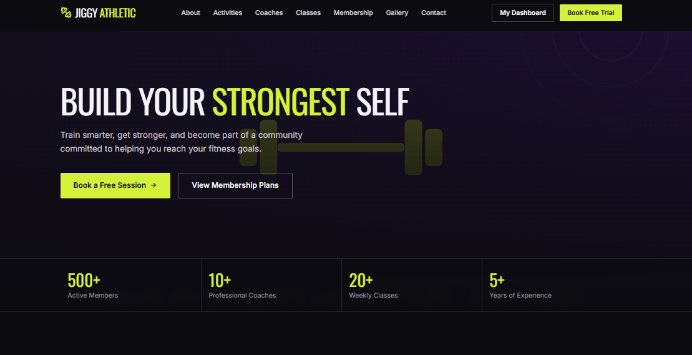

### Class Schedule and Booking
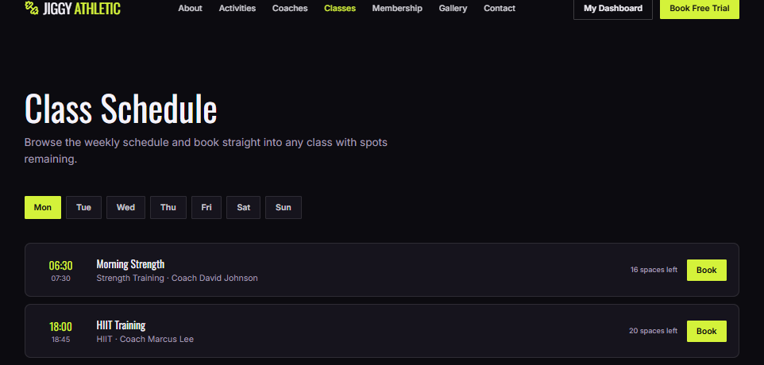

### Membership Plans
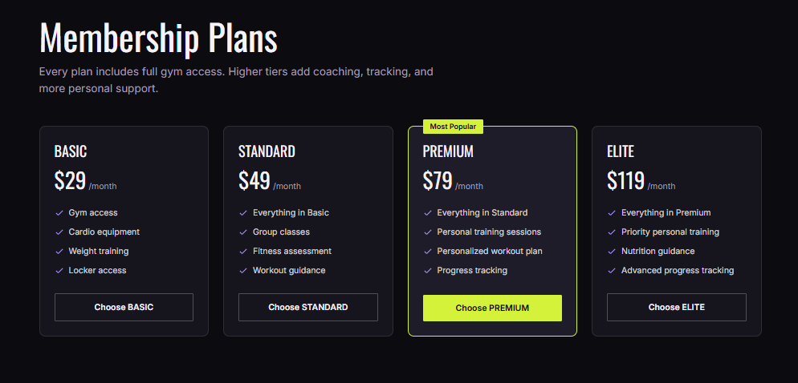

### Member Dashboard
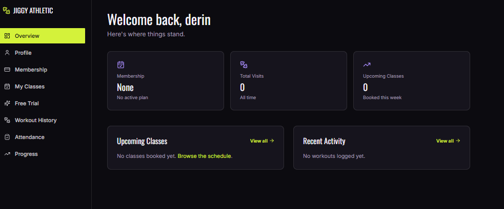

### Admin Panel
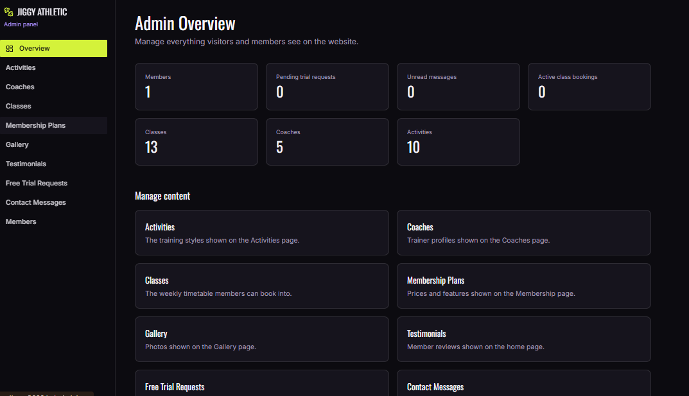

<details>
<summary><b>More screenshots</b></summary>

| Free Trial Booking | Coaches |
| :---: | :---: |
| 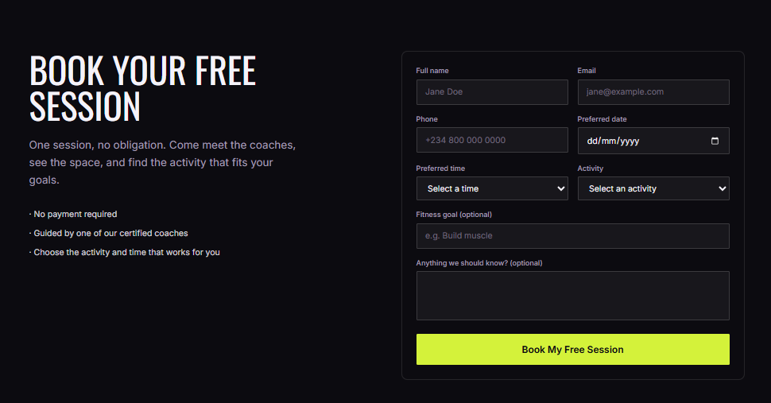 | 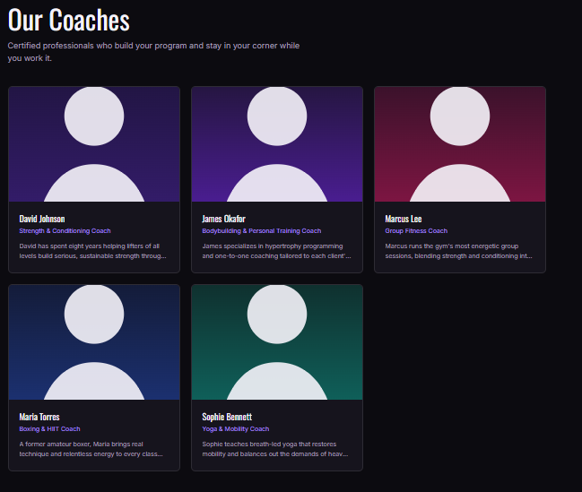 |

| Login | Register |
| :---: | :---: |
| 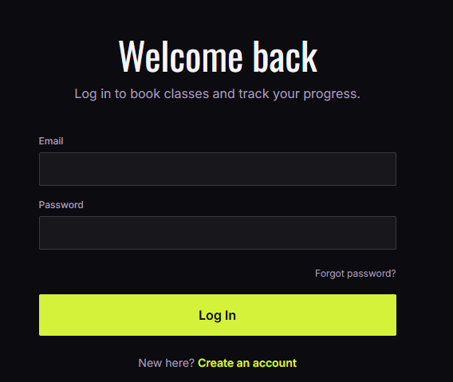 | 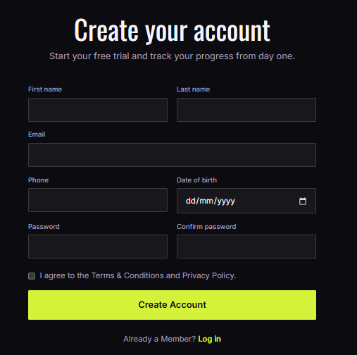 |

| Progress Tracking | Admin: Edit Form |
| :---: | :---: |
| 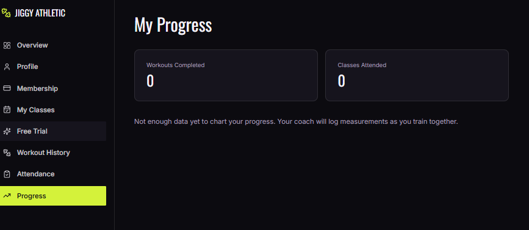 | 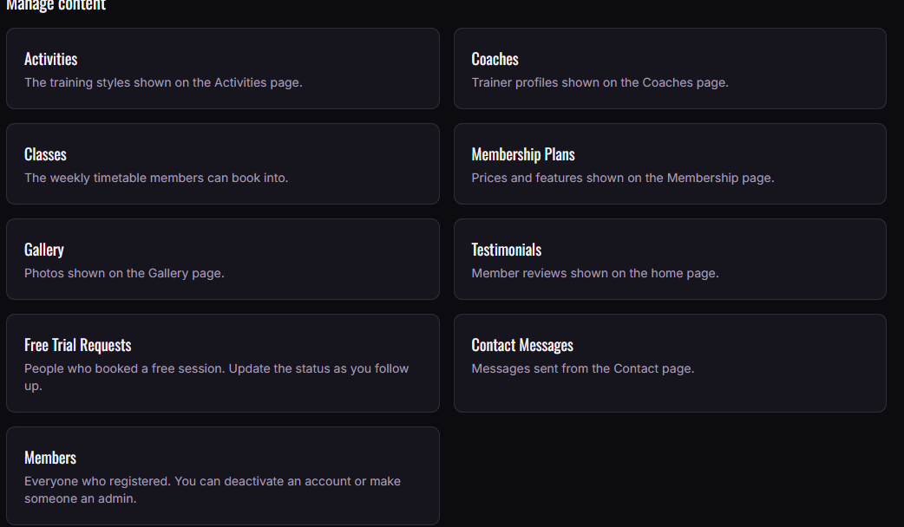 |

| Mobile View |
| :---: |
| 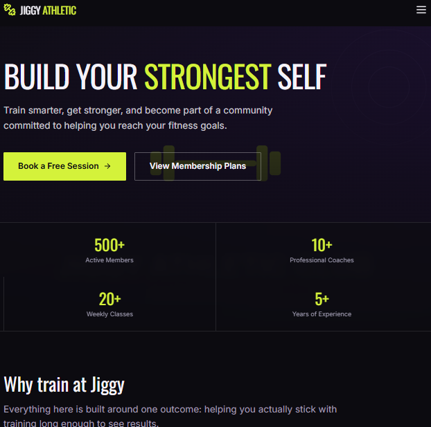 |

</details>

---

## 🧰 Tech Stack

| Layer | Technology |
| --- | --- |
| Frontend | Next.js 14 (App Router), React 18, TypeScript, Tailwind CSS, Framer Motion |
| Forms and validation | React Hook Form, Zod |
| Charts | Recharts |
| Backend | Node.js, Express, TypeScript |
| ORM | Prisma |
| Database | PostgreSQL on Supabase |
| Auth | JWT (httpOnly cookie), bcrypt |

---

## 📁 Project Structure

```
gym-platform/
├── backend/
│   ├── prisma/
│   │   ├── schema.prisma      # Data models
│   │   └── seed.ts            # Demo content and admin account
│   └── src/
│       ├── routes/            # Express routers (including admin)
│       ├── controllers/       # Request handlers
│       ├── middleware/        # Auth, validation, cache, errors
│       ├── validation/        # Zod schemas
│       └── lib/ utils/        # Prisma client, JWT, helpers
├── frontend/
│   ├── public/images/         # Placeholder images
│   └── src/
│       ├── app/               # Pages: public site, /dashboard, /admin
│       ├── components/        # Navbar, forms, cards, schedule
│       ├── lib/               # API client, auth context, admin config
│       └── types/
└── docs/
    └── screenshots/           # README images
```

---

## 🚀 Getting Started

### Prerequisites
- Node.js 18 or newer
- A free [Supabase](https://supabase.com) project

### 1. Get the code

```bash
git clone <your-repo-url>
cd gym-platform
```

### 2. Backend

```bash
cd backend
cp .env.example .env
npm install
```

Edit `backend/.env`:

```env
# Supabase: click "Connect" on your project dashboard
# Transaction pooler string (port 6543)
DATABASE_URL="postgresql://postgres.<ref>:<PASSWORD>@aws-0-<region>.pooler.supabase.com:6543/postgres?pgbouncer=true"

# Session pooler string (port 5432), used for migrations
DIRECT_URL="postgresql://postgres.<ref>:<PASSWORD>@aws-0-<region>.pooler.supabase.com:5432/postgres"

JWT_SECRET="a-long-random-string"
JWT_EXPIRES_IN="7d"

# Admin account created by `npm run seed`
ADMIN_EMAIL="admin@jiggyathletic.club"
ADMIN_PASSWORD="choose-a-strong-password"

PORT=4000
NODE_ENV=development
FRONTEND_URL="http://localhost:3000"
```

Create the tables, load demo content, and start the API:

```bash
npx prisma migrate dev --name init
npm run seed
npm run dev
```

The API runs at `http://localhost:4000`. Check `GET /health`.

### 3. Frontend

```bash
cd frontend
cp .env.local.example .env.local
npm install
npm run dev
```

Open `http://localhost:3000`.

Both servers must be running. The website gets all its content from the API.

---

## 🛡 Admin Panel

Log in at `/login` with the `ADMIN_EMAIL` and `ADMIN_PASSWORD` from your `.env`. You are sent to `/admin` automatically, and an **Admin Panel** button appears in the top menu.

| Section | What you can do |
| --- | --- |
| Activities, Coaches, Classes | Add, edit, delete or hide items |
| Membership Plans | Change prices, features and the "Most Popular" badge |
| Gallery, Testimonials | Add photos and reviews by image URL |
| Free Trial Requests | See who booked and set the status |
| Contact Messages | Read messages and mark them as read |
| Members | Deactivate accounts or make someone an admin |

To manage a new table, add it to `backend/src/routes/adminRoutes.ts` and `frontend/src/lib/adminConfig.ts`.

> Change the admin password after your first login, and never commit your `.env` file.

---

## 🔌 API Overview

| Area | Endpoints |
| --- | --- |
| Auth | `POST /api/auth/register` · `login` · `logout` · `forgot-password` · `reset-password` · `GET /me` |
| Activities | `GET /api/activities` · `GET /api/activities/:slug` |
| Coaches | `GET /api/coaches` · `GET /api/coaches/:id` |
| Classes | `GET /api/classes?day=` · `POST /api/classes/book` · `PATCH /api/classes/bookings/:id/cancel` |
| Memberships | `GET /api/memberships/plans` · `GET /api/memberships/me` |
| Free trial | `POST /api/free-trial` · `GET /api/free-trial/me` · `PATCH /api/free-trial/:id/cancel` |
| Member | `GET/PUT /api/members/profile` |
| Dashboard | `GET /api/dashboard/overview` · `classes` · `attendance` · `workouts` · `progress` |
| Content | `GET /api/gallery` · `GET /api/blog` · `GET /api/blog/:slug` · `GET /api/testimonials` · `POST /api/contact` |
| Admin | `GET/POST/PUT/DELETE /api/admin/:resource` · `GET /api/admin/stats` (admin only) |

Responses use one envelope:

```json
{ "success": true, "data": { } }
{ "success": false, "error": { "message": "..." } }
```

---


## 🗺 Roadmap

- [ ] Admin tools for workouts, attendance check-ins and blog posts
- [ ] Payments (Stripe or Paystack) tied to membership plans
- [ ] Transactional emails (booking confirmations, password reset)
- [ ] Image uploads in the admin panel (Supabase Storage)
- [ ] Waitlists for full classes

---
## 👨‍💻 Author

Atunde Toheeb Ayomide (Jiggy)  
📍 Lagos, Nigeria  
📧 [atundetoheeb1@gmail.com](mailto:atundetoheeb1@gmail.com)  
🔗 [GitHub](https://github.com/ceezign) | [LinkedIn](https://www.linkedin.com/in/atunde-toheeb-551826313)
💼 [Website](https://atunde-portfolio-web.vercel.app/)

## 📄 License

MIT — free to use, modify, and share.

